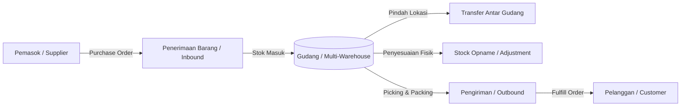

# Dokumentasi Inventory Management System (IMS)

Selamat datang di repositori dokumentasi **Inventory Management System (IMS)** berbasis backend **Rust**. Dokumen ini dirancang untuk memberikan panduan komprehensif mulai dari perancangan arsitektur, kebutuhan sistem, skema basis data, spesifikasi API, hingga panduan pengembangan dan deployment.

---

## 📌 Ringkasan Proyek

Sistem Manajemen Inventaris ini bertujuan untuk mengelola, melacak, dan mengoptimalkan persediaan barang secara *real-time* di berbagai gudang (*multi-warehouse*). Dengan menggunakan **Rust**, sistem ini mengedepankan performa tinggi, keandalan memori (*memory safety*), serta integritas data yang ketat (*zero-data-loss & strict concurrency control*).

### Keunggulan Penggunaan Rust
- **Performa & Latensi Rendah**: Cocok untuk transaksi inventaris intensif tanpa overhead *garbage collection*.
- **Memory Safety & Concurrency**: Menjamin keamanan thread secara native, meminimalkan bug *race conditions* saat mutasi stok bersamaan.
- **Strict Typing**: Memastikan validasi domain dan status inventaris terverifikasi sejak waktu kompilasi (*compile-time*).

---

## 📚 Struktur Dokumentasi

Dokumentasi proyek dibagi menjadi beberapa berkas modular berikut:

| Berkas | Deskripsi |
| :--- | :--- |
| [**architecture.md**](./architecture.md) | Arsitektur sistem, pemilihan tech stack, pola desain (*Clean Architecture*), dan penanganan konkurensi stok. |
| [**requirements.md**](./requirements.md) | Spesifikasi kebutuhan fungsional (FR) & non-fungsional (NFR), peran pengguna (*RBAC*), dan alur bisnis. |
| [**database.md**](./database.md) | ERD (*Entity Relationship Diagram*), skema tabel PostgreSQL, strategi locking (*pessimistic locking*), dan audit log. |
| [**api.md**](./api.md) | Spesifikasi RESTful API, otentikasi JWT, format respons terstandar, dan daftar endpoint utama. |
| [**domain-model.md**](./domain-model.md) | Pemodelan domain (DDD), *invariants* bisnis, *value objects*, dan contoh representasi idiomatik dalam Rust. |
| [**development.md**](./development.md) | Panduan instalasi lokal, dependensi, konfigurasi Docker, migrasi database, dan pengujian (*testing*). |
| [**Postman Collection**](../postman/inventory_system.postman_collection.json) | File koleksi Postman v2.1 siap pakai untuk uji coba seluruh endpoint API. |

---

## 🛠️ Ringkasan Tech Stack

- **Bahasa Pemrograman**: Rust (Edisi 2021 / MSRV 1.78+)
- **Web Framework**: [Axum](https://github.com/tokio-rs/axum) (berjalan di atas runtime [Tokio](https://tokio.rs))
- **Database Access / ORM**: [SQLx](https://github.com/launchbadge/sqlx) (asinkron dengan verifikasi query saat *compile-time*)
- **Primary Database**: PostgreSQL 16+
- **Caching & Rate Limiting**: Redis 7+
- **Serialisasi**: [Serde](https://serde.rs) (JSON)
- **Logging & Tracing**: [Tracing](https://github.com/tokio-rs/tracing) & OpenTelemetry
- **Validasi**: [Validator](https://github.com/Keats/validator)

---

## 🚀 Alur Kerja Utama Sistem

---

## 🗺️ Roadmap Pengembangan

- [ ] **Fase 1: Fondasi & Auth**
  - Setup struktur proyek Rust (Modular / Workspace)
  - Integrasi PostgreSQL via SQLx & migration runner
  - Autentikasi JWT, password hashing (Argon2), dan RBAC
- [ ] **Fase 2: Master Data & Multi-Warehouse**
  - Manajemen Produk, Kategori, Varian (SKU & Barcode)
  - Manajemen Gudang, Zona, dan Rak/Bin Location
- [ ] **Fase 3: Transaksi & Ledger Stok**
  - Sistem mutasi stok (*Double-entry inventory ledger*)
  - Mutasi stok dengan *pessimistic locking* (`FOR UPDATE`)
  - Stock Inbound, Outbound, Transfer, dan Stock Opname (Adjustment)
- [ ] **Fase 4: Pengadaan & Notifikasi**
  - Purchase Order & Supplier management
  - Ambang batas stok rendah (*Low Stock Alert*) via background worker / cron
- [ ] **Fase 5: Observabilitas & Deployment**
  - Health check endpoint, Prometheus metrics, tracing
  - Multi-stage Dockerfile & CI/CD pipeline
