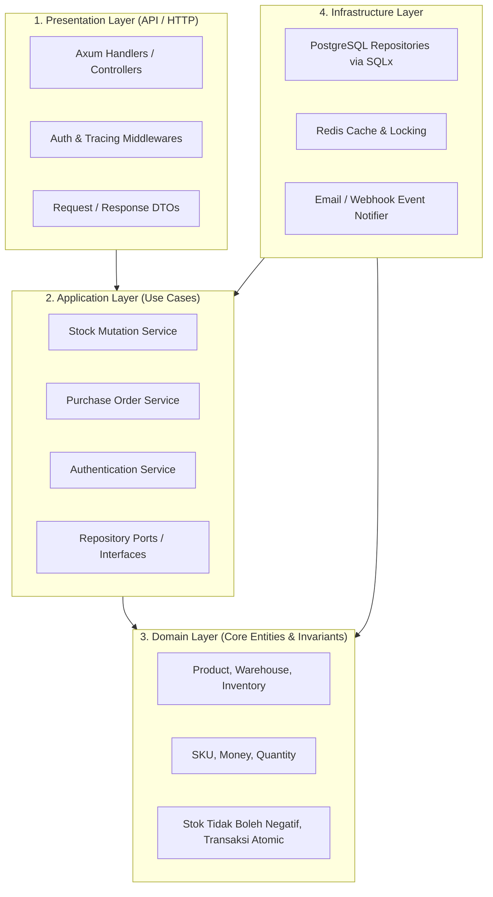
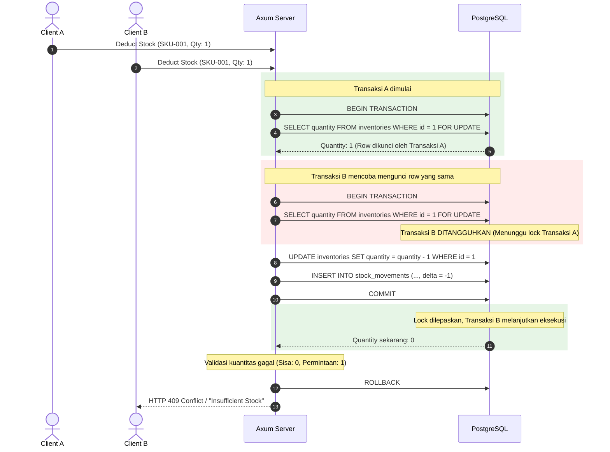

# Arsitektur Sistem (System Architecture)

Dokumen ini menjelaskan rancangan arsitektur perangkat lunak untuk **Inventory Management System (IMS)** berbasis backend Rust.

---

## 🏛️ Pola Arsitektur: Clean Architecture / Hexagonal

Untuk memastikan kode modular, mudah diuji (*testable*), serta independen dari framework dan database, sistem mengadopsi prinsip **Clean Architecture**:



### Penjelasan Layer:
1. **Domain Layer**:
   - Berisi entitas inti bisnis dan *invariants* (aturan bisnis murni tanpa ketergantungan pihak ketiga).
   - Ditulis menggunakan tipe data murni Rust (Structs, Enums) tanpa dependensi eksternal selain *standard library* dan utilitas dasar.
2. **Application Layer**:
   - Mengimplementasikan alur use-case (misal: `DeductStockUseCase`, `TransferStockUseCase`).
   - Mendefinisikan antarmuka *Traits* (Ports) untuk repository dan layanan eksternal.
3. **Infrastructure Layer**:
   - Mengimplementasikan *Traits* menggunakan teknologi spesifik (PostgreSQL via SQLx, Redis client).
   - Menangani detail I/O, migrasi basis data, dan konfigurasi jaringan.
4. **Presentation Layer**:
   - Routing HTTP menggunakan **Axum**.
   - Validasi payload request, otentikasi JWT middleware, dan mapping domain error ke HTTP status code yang sesuai (RFC 7807).

---

## 📦 Pilihan Tech Stack & Ekosistem Crates

| Komponen | Pustaka / Crate | Alasan Pemilihan |
| :--- | :--- | :--- |
| **Async Runtime** | `tokio` (full) | Standar de-facto ekosistem Rust asinkron, performa dan skalabilitas tinggi. |
| **Web Framework** | `axum` | Framework resmi dari tim Tokio; integrasi mendalam dengan `tower` dan tipe data aman. |
| **Database Client** | `sqlx` (postgres, runtime-tokio) | Dukungan query asinkron murni dengan **compile-time query verification** (mencegah SQL syntax error sebelum kode dijalankan). |
| **Data Serialization** | `serde`, `serde_json` | Standar serialisasi/deserialisasi zero-copy tercepat di Rust. |
| **Password Hashing** | `argon2` | Algoritma hashing pemenang PHC, tahan serangan GPU/ASIC untuk keamanan kredensial. |
| **JWT Tokens** | `jsonwebtoken` | Token stateless yang efisien untuk autentikasi API. |
| **Data Validation** | `validator` | Deklarasi validasi field (panjang string, range angka, format email/SKU) via Rust derive macro. |
| **Error Handling** | `thiserror` (domain) & `anyhow` | Error berbasis Enum yang *strongly-typed* untuk kontrol alur dan respons HTTP yang presisi. |
| **Logging & Tracing** | `tracing`, `tracing-subscriber` | Diagnostik terstruktur asinkron dengan context propagation. |

---

## 🔒 Strategi Penanganan Konkurensi & Integritas Stok

Tantangan terbesar dalam sistem inventaris adalah **race condition** ketika beberapa transaksi mencoba memotong stok item yang sama secara bersamaan (misalnya sisa stok 1, namun dua pesanan masuk pada milidetik yang sama).

### Strategi Pertahanan Bertingkat:



1. **Row-Level Pessimistic Locking (`SELECT ... FOR UPDATE`)**:
   Setiap mutasi stok membaca baris inventaris dalam blok transaksi dengan lock eksklusif baris (*pessimistic lock*), mencegah modifikasi paralel pada item di gudang yang sama.
2. **Database CHECK Constraint**:
   Di level DDL PostgreSQL, diterapkan aturan:
   ```sql
   CONSTRAINT chk_inventory_qty_non_negative CHECK (quantity >= 0)
   ```
   Bahkan jika terjadi kegagalan logika aplikasi, basis data akan membatalkan (*abort/rollback*) transaksi secara otomatis jika kuantitas jatuh di bawah 0.
3. **Double-Entry Stock Ledger (Audit Trail)**:
   Semua perubahan kuantitas dicatat dalam tabel riwayat mutasi (*stock movements*) yang bersifat *append-only* (tidak boleh di-UPDATE atau di-DELETE).

---

## 🗂️ Rekomendasi Struktur Direktori Proyek

Proyek dapat diorganisir menggunakan struktur modular yang rapi:

```text
inventory-system/
├── Cargo.toml
├── Cargo.lock
├── .env.example
├── Dockerfile
├── docker-compose.yml
├── migrations/                     # File migrasi SQLx
│   ├── 20260101_init_schema.sql
│   └── 20260102_add_stock_tables.sql
├── docs/                           # Dokumentasi Markdown
│   ├── README.md
│   ├── architecture.md
│   ├── requirements.md
│   ├── database.md
│   ├── api.md
│   ├── domain-model.md
│   └── development.md
└── src/
    ├── main.rs                     # Entrypoint & konfigurasi server
    ├── config.rs                   # Pengaturan environment & app settings
    ├── error.rs                    # Definisi AppError & HTTP conversion
    ├── api/                        # Layer Presentasi
    │   ├── mod.rs
    │   ├── router.rs
    │   ├── middlewares/            # JWT auth, rate limiter, request logger
    │   └── v1/
    │       ├── auth_handlers.rs
    │       ├── product_handlers.rs
    │       ├── warehouse_handlers.rs
    │       ├── stock_handlers.rs
    │       └── po_handlers.rs
    ├── application/                # Layer Aplikasi (Use Cases)
    │   ├── mod.rs
    │   ├── auth_service.rs
    │   ├── stock_service.rs
    │   └── po_service.rs
    ├── domain/                     # Layer Domain (Pure Entities & Traits)
    │   ├── mod.rs
    │   ├── product.rs
    │   ├── warehouse.rs
    │   ├── inventory.rs
    │   └── repositories/           # Trait definition untuk repository
    │       ├── product_repo.rs
    │       └── inventory_repo.rs
    └── infrastructure/             # Layer Infrastruktur (SQLx, Redis, etc.)
        ├── mod.rs
        ├── database.rs             # Database pool setup
        └── repositories/           # Implementasi Trait dengan SQLx
            ├── pg_product_repo.rs
            └── pg_inventory_repo.rs
```
