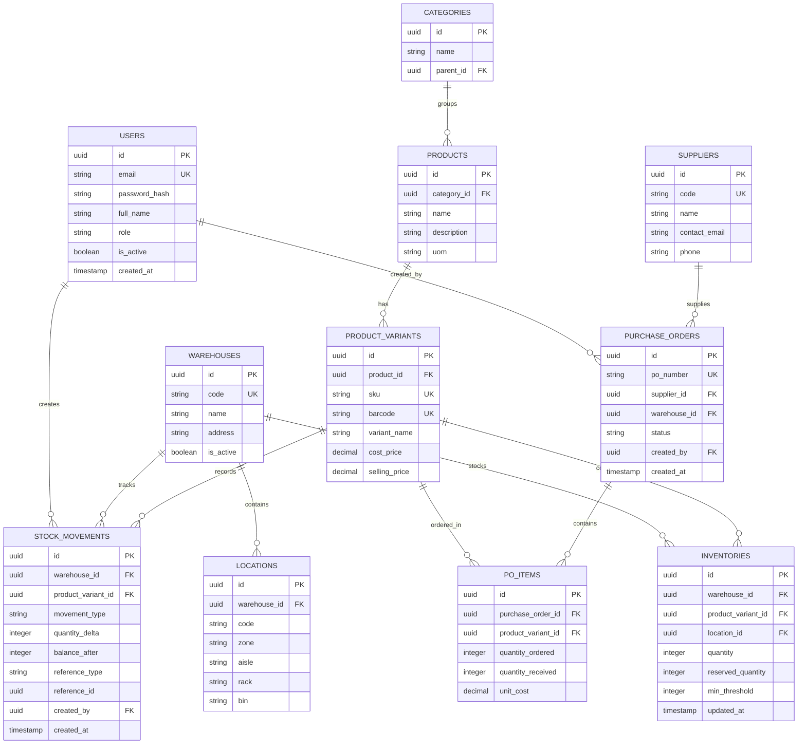

# Desain Skema Basis Data (Database Schema)

Dokumen ini memuat Entity Relationship Diagram (ERD), Data Definition Language (DDL) PostgreSQL, rancangan indeks, serta pola transaksi untuk **Inventory Management System**.

---

## 📊 Entity Relationship Diagram (ERD)



---

## 🗄️ Spesifikasi DDL (PostgreSQL)

Berikut adalah skema DDL yang dioptimalkan untuk performa dan integritas data:

```sql
-- Ekstensi untuk UUID
CREATE EXTENSION IF NOT EXISTS "pgcrypto";

-- ============================================================================
-- 1. PENGGUNA & AUTENTIKASI
-- ============================================================================
CREATE TYPE user_role AS ENUM ('SUPER_ADMIN', 'WAREHOUSE_MANAGER', 'STAFF', 'AUDITOR');

CREATE TABLE users (
    id UUID PRIMARY KEY DEFAULT gen_random_uuid(),
    email VARCHAR(255) NOT NULL UNIQUE,
    password_hash VARCHAR(255) NOT NULL,
    full_name VARCHAR(150) NOT NULL,
    role user_role NOT NULL DEFAULT 'STAFF',
    is_active BOOLEAN NOT NULL DEFAULT TRUE,
    created_at TIMESTAMPTZ NOT NULL DEFAULT NOW(),
    updated_at TIMESTAMPTZ NOT NULL DEFAULT NOW()
);

-- ============================================================================
-- 2. GUDANG & LOKASI PENYIMPANAN
-- ============================================================================
CREATE TABLE warehouses (
    id UUID PRIMARY KEY DEFAULT gen_random_uuid(),
    code VARCHAR(30) NOT NULL UNIQUE,
    name VARCHAR(150) NOT NULL,
    address TEXT,
    is_active BOOLEAN NOT NULL DEFAULT TRUE,
    created_at TIMESTAMPTZ NOT NULL DEFAULT NOW(),
    updated_at TIMESTAMPTZ NOT NULL DEFAULT NOW()
);

CREATE TABLE locations (
    id UUID PRIMARY KEY DEFAULT gen_random_uuid(),
    warehouse_id UUID NOT NULL REFERENCES warehouses(id) ON DELETE RESTRICT,
    code VARCHAR(50) NOT NULL, -- Contoh: 'WH1-Z1-A02-R03-B01'
    zone VARCHAR(20),
    aisle VARCHAR(20),
    rack VARCHAR(20),
    bin VARCHAR(20),
    is_active BOOLEAN NOT NULL DEFAULT TRUE,
    created_at TIMESTAMPTZ NOT NULL DEFAULT NOW(),
    CONSTRAINT uq_warehouse_location UNIQUE(warehouse_id, code)
);

-- ============================================================================
-- 3. KATALOG PRODUK
-- ============================================================================
CREATE TABLE categories (
    id UUID PRIMARY KEY DEFAULT gen_random_uuid(),
    parent_id UUID REFERENCES categories(id) ON DELETE SET NULL,
    name VARCHAR(100) NOT NULL UNIQUE,
    created_at TIMESTAMPTZ NOT NULL DEFAULT NOW()
);

CREATE TABLE products (
    id UUID PRIMARY KEY DEFAULT gen_random_uuid(),
    category_id UUID NOT NULL REFERENCES categories(id) ON DELETE RESTRICT,
    name VARCHAR(200) NOT NULL,
    description TEXT,
    uom VARCHAR(20) NOT NULL DEFAULT 'PCS', -- Unit of Measure
    created_at TIMESTAMPTZ NOT NULL DEFAULT NOW(),
    updated_at TIMESTAMPTZ NOT NULL DEFAULT NOW()
);

CREATE TABLE product_variants (
    id UUID PRIMARY KEY DEFAULT gen_random_uuid(),
    product_id UUID NOT NULL REFERENCES products(id) ON DELETE CASCADE,
    sku VARCHAR(60) NOT NULL UNIQUE,
    barcode VARCHAR(60) UNIQUE,
    variant_name VARCHAR(100) NOT NULL, -- e.g., 'Merah - XL'
    cost_price NUMERIC(15, 2) NOT NULL DEFAULT 0.00,
    selling_price NUMERIC(15, 2) NOT NULL DEFAULT 0.00,
    created_at TIMESTAMPTZ NOT NULL DEFAULT NOW(),
    updated_at TIMESTAMPTZ NOT NULL DEFAULT NOW()
);

CREATE INDEX idx_variants_sku ON product_variants(sku);
CREATE INDEX idx_variants_barcode ON product_variants(barcode);

-- ============================================================================
-- 4. INVENTARIS & STOK
-- ============================================================================
CREATE TABLE inventories (
    id UUID PRIMARY KEY DEFAULT gen_random_uuid(),
    warehouse_id UUID NOT NULL REFERENCES warehouses(id) ON DELETE RESTRICT,
    product_variant_id UUID NOT NULL REFERENCES product_variants(id) ON DELETE RESTRICT,
    location_id UUID REFERENCES locations(id) ON DELETE SET NULL,
    quantity INTEGER NOT NULL DEFAULT 0,
    reserved_quantity INTEGER NOT NULL DEFAULT 0,
    min_threshold INTEGER NOT NULL DEFAULT 5,
    created_at TIMESTAMPTZ NOT NULL DEFAULT NOW(),
    updated_at TIMESTAMPTZ NOT NULL DEFAULT NOW(),
    
    -- Invariants penting: Stok tidak boleh minus & reserved tidak boleh melebihi quantity
    CONSTRAINT chk_quantity_non_negative CHECK (quantity >= 0),
    CONSTRAINT chk_reserved_non_negative CHECK (reserved_quantity >= 0),
    CONSTRAINT chk_reserved_lte_quantity CHECK (reserved_quantity <= quantity),
    CONSTRAINT uq_warehouse_variant UNIQUE(warehouse_id, product_variant_id)
);

CREATE INDEX idx_inventory_lookup ON inventories(warehouse_id, product_variant_id);

-- ============================================================================
-- 5. BUKU BESAR MUTASI STOK (STOCK MOVEMENTS / AUDIT LEDGER)
-- ============================================================================
CREATE TYPE movement_type AS ENUM (
    'INBOUND_PO', 
    'OUTBOUND_SALES', 
    'TRANSFER_IN', 
    'TRANSFER_OUT', 
    'ADJUSTMENT_ADD', 
    'ADJUSTMENT_SUB'
);

CREATE TABLE stock_movements (
    id UUID PRIMARY KEY DEFAULT gen_random_uuid(),
    warehouse_id UUID NOT NULL REFERENCES warehouses(id),
    product_variant_id UUID NOT NULL REFERENCES product_variants(id),
    movement_type movement_type NOT NULL,
    quantity_delta INTEGER NOT NULL, -- Positif untuk masuk, negatif untuk keluar
    balance_after INTEGER NOT NULL,  -- Snapshot saldo setelah mutasi
    reference_type VARCHAR(50) NOT NULL, -- e.g., 'PURCHASE_ORDER', 'SALES_ORDER', 'STOCK_OPNAME'
    reference_id UUID,
    notes TEXT,
    created_by UUID REFERENCES users(id),
    created_at TIMESTAMPTZ NOT NULL DEFAULT NOW()
);

-- Index untuk mempercepat rekap riwayat stok
CREATE INDEX idx_movements_variant ON stock_movements(product_variant_id, created_at DESC);
CREATE INDEX idx_movements_warehouse ON stock_movements(warehouse_id, created_at DESC);

-- ============================================================================
-- 6. PENGADAAN (SUPPLIER & PURCHASE ORDERS)
-- ============================================================================
CREATE TABLE suppliers (
    id UUID PRIMARY KEY DEFAULT gen_random_uuid(),
    code VARCHAR(50) NOT NULL UNIQUE,
    name VARCHAR(200) NOT NULL,
    contact_email VARCHAR(255),
    phone VARCHAR(50),
    address TEXT,
    is_active BOOLEAN NOT NULL DEFAULT TRUE,
    created_at TIMESTAMPTZ NOT NULL DEFAULT NOW()
);

CREATE TYPE po_status AS ENUM ('DRAFT', 'ISSUED', 'PARTIALLY_RECEIVED', 'RECEIVED', 'CANCELLED');

CREATE TABLE purchase_orders (
    id UUID PRIMARY KEY DEFAULT gen_random_uuid(),
    po_number VARCHAR(50) NOT NULL UNIQUE,
    supplier_id UUID NOT NULL REFERENCES suppliers(id) ON DELETE RESTRICT,
    warehouse_id UUID NOT NULL REFERENCES warehouses(id) ON DELETE RESTRICT,
    status po_status NOT NULL DEFAULT 'DRAFT',
    total_amount NUMERIC(15, 2) NOT NULL DEFAULT 0.00,
    created_by UUID REFERENCES users(id),
    created_at TIMESTAMPTZ NOT NULL DEFAULT NOW(),
    updated_at TIMESTAMPTZ NOT NULL DEFAULT NOW()
);

CREATE TABLE purchase_order_items (
    id UUID PRIMARY KEY DEFAULT gen_random_uuid(),
    purchase_order_id UUID NOT NULL REFERENCES purchase_orders(id) ON DELETE CASCADE,
    product_variant_id UUID NOT NULL REFERENCES product_variants(id) ON DELETE RESTRICT,
    quantity_ordered INTEGER NOT NULL CHECK (quantity_ordered > 0),
    quantity_received INTEGER NOT NULL DEFAULT 0 CHECK (quantity_received >= 0),
    unit_cost NUMERIC(15, 2) NOT NULL,
    CONSTRAINT uq_po_variant UNIQUE (purchase_order_id, product_variant_id)
);
```

---

## 🔒 Pola Transaksi Asinkron di Rust (Pessimistic Locking)

Berikut adalah pola transaksi mutasi stok yang dieksekusi melalui **SQLx**:

```rust
// Contoh kode Rust: Mengurangi stok secara aman dalam transaksi
pub async fn deduct_stock(
    pool: &PgPool,
    warehouse_id: Uuid,
    variant_id: Uuid,
    qty_to_deduct: i32,
    order_id: Uuid,
    user_id: Uuid,
) -> Result<(), DomainError> {
    let mut tx = pool.begin().await?;

    // 1. Kunci row inventaris secara eksklusif (Pessimistic Lock)
    let inventory = sqlx::query!(
        r#"
        SELECT id, quantity, reserved_quantity 
        FROM inventories 
        WHERE warehouse_id = $1 AND product_variant_id = $2
        FOR UPDATE
        "#,
        warehouse_id,
        variant_id
    )
    .fetch_optional(&mut *tx)
    .await?
    .ok_or(DomainError::ItemNotFound)?;

    let available = inventory.quantity - inventory.reserved_quantity;
    if available < qty_to_deduct {
        return Err(DomainError::InsufficientStock {
            available,
            requested: qty_to_deduct,
        });
    }

    let new_quantity = inventory.quantity - qty_to_deduct;

    // 2. Perbarui jumlah stok
    sqlx::query!(
        r#"
        UPDATE inventories 
        SET quantity = $1, updated_at = NOW() 
        WHERE id = $2
        "#,
        new_quantity,
        inventory.id
    )
    .execute(&mut *tx)
    .await?;

    // 3. Catat audit ledger ke tabel stock_movements (Append-only)
    sqlx::query!(
        r#"
        INSERT INTO stock_movements (
            warehouse_id, product_variant_id, movement_type, 
            quantity_delta, balance_after, reference_type, 
            reference_id, created_by
        )
        VALUES ($1, $2, 'OUTBOUND_SALES', $3, $4, 'SALES_ORDER', $5, $6)
        "#,
        warehouse_id,
        variant_id,
        -qty_to_deduct,
        new_quantity,
        order_id,
        user_id
    )
    .execute(&mut *tx)
    .await?;

    // 4. Commit transaksi (Lock dilepaskan)
    tx.commit().await?;

    Ok(())
}
```
