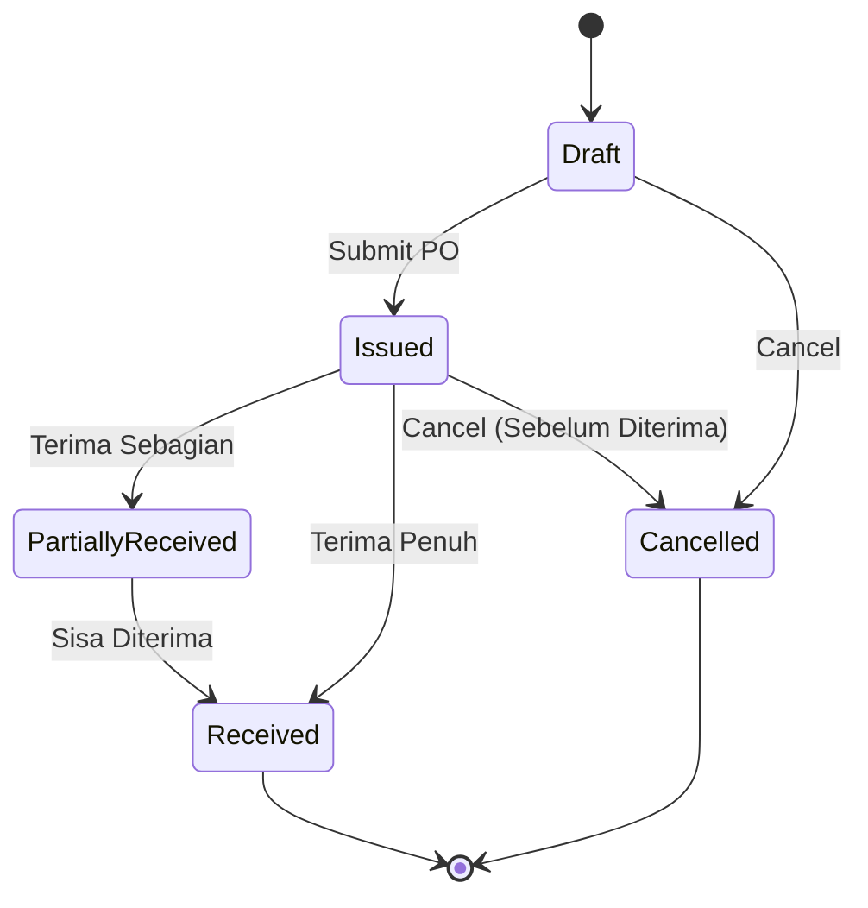

# Pemodelan Domain (Domain Model & Invariants)

Dokumen ini menjelaskan rancangan domain bisnis berbasis **Domain-Driven Design (DDD)** yang diimplementasikan secara idiomatik dalam bahasa **Rust**.

---

## 🎯 Prinsip Pemodelan Domain di Rust

Rust menyediakan sistem tipe (*type system*) yang sangat ekspresif. Kami memanfaatkan fitur:
1. **Newtype Pattern**: Menghindari *primitive obsession* (misal: membedakan tipe data `Sku` dengan `String` biasa).
2. **Parse, Don't Validate**: Konstruktor tipe domain selalu memvalidasi input sebelum mengembalikan instance yang valid (`Result<T, DomainError>`).
3. **State Machine via Enums**: Menjamin transisi status hanya dapat terjadi sesuai aturan bisnis yang sah (*type-safe state machine*).

---

## 💎 Value Objects

### 1. SKU (Stock Keeping Unit)
SKU harus selalu berupa huruf kapital alfanumerik dengan tanda hubung (*hyphen*), panjang 3–50 karakter:

```rust
use std::fmt;
use crate::error::DomainError;

#[derive(Debug, Clone, PartialEq, Eq, Hash)]
pub struct Sku(String);

impl Sku {
    pub fn new(raw: impl Into<String>) -> Result<Self, DomainError> {
        let val = raw.into().trim().to_uppercase();
        if val.len() < 3 || val.len() > 50 {
            return Err(DomainError::InvalidSku("Panjang SKU harus 3-50 karakter".into()));
        }
        if !val.chars().all(|c| c.is_ascii_alphanumeric() || c == '-') {
            return Err(DomainError::InvalidSku("SKU hanya boleh berisi alfanumerik dan tanda hubung".into()));
        }
        Ok(Self(val))
    }

    pub fn as_str(&self) -> &str {
        &self.0
    }
}
```

### 2. Kuantitas Stok (Quantity)
Menjamin stok di memori aplikasi tidak pernah bernilai negatif:

```rust
#[derive(Debug, Clone, Copy, PartialEq, Eq, PartialOrd, Ord)]
pub struct StockQuantity(u32);

impl StockQuantity {
    pub fn zero() -> Self {
        Self(0)
    }

    pub fn new(val: u32) -> Self {
        Self(val)
    }

    pub fn value(&self) -> u32 {
        self.0
    }

    pub fn checked_add(self, delta: u32) -> Result<Self, DomainError> {
        self.0
            .checked_add(delta)
            .map(Self)
            .ok_or(DomainError::QuantityOverflow)
    }

    pub fn checked_sub(self, delta: u32) -> Result<Self, DomainError> {
        self.0
            .checked_sub(delta)
            .map(Self)
            .ok_or(DomainError::NegativeStock)
    }
}
```

---

## 📦 Aggregate: Inventaris Gudang (WarehouseInventory)

Aggregate Root ini bertanggung jawab menjaga konsistensi antara stok fisik (*on-hand*) dan stok yang dialokasikan (*reserved*).

### Invariants Bisnis:
1. $\text{Quantity} \ge 0$
2. $\text{ReservedQuantity} \ge 0$
3. $\text{ReservedQuantity} \le \text{Quantity}$
4. $\text{AvailableQuantity} = \text{Quantity} - \text{ReservedQuantity}$

```rust
use uuid::Uuid;
use crate::error::DomainError;

#[derive(Debug, Clone)]
pub struct WarehouseInventory {
    id: Uuid,
    warehouse_id: Uuid,
    product_variant_id: Uuid,
    quantity: StockQuantity,
    reserved_quantity: StockQuantity,
    min_threshold: StockQuantity,
}

impl WarehouseInventory {
    pub fn new(warehouse_id: Uuid, product_variant_id: Uuid, min_threshold: u32) -> Self {
        Self {
            id: Uuid::new_v4(),
            warehouse_id,
            product_variant_id,
            quantity: StockQuantity::zero(),
            reserved_quantity: StockQuantity::zero(),
            min_threshold: StockQuantity::new(min_threshold),
        }
    }

    /// Kuantitas stok yang siap dijual atau dipindahkan
    pub fn available_quantity(&self) -> u32 {
        self.quantity.value() - self.reserved_quantity.value()
    }

    /// Mengalokasikan/mereservasi stok untuk pesanan keluar
    pub fn reserve_stock(&mut self, amount: u32) -> Result<(), DomainError> {
        if self.available_quantity() < amount {
            return Err(DomainError::InsufficientAvailableStock {
                available: self.available_quantity(),
                requested: amount,
            });
        }
        self.reserved_quantity = self.reserved_quantity.checked_add(amount)?;
        Ok(())
    }

    /// Memotong stok aktual saat pesanan dikirim (dispatched)
    pub fn fulfill_reservation(&mut self, amount: u32) -> Result<(), DomainError> {
        if self.reserved_quantity.value() < amount {
            return Err(DomainError::InvalidReservationRelease);
        }
        self.reserved_quantity = self.reserved_quantity.checked_sub(amount)?;
        self.quantity = self.quantity.checked_sub(amount)?;
        Ok(())
    }

    /// Menambah stok dari penerimaan barang (Inbound)
    pub fn receive_stock(&mut self, amount: u32) -> Result<(), DomainError> {
        self.quantity = self.quantity.checked_add(amount)?;
        Ok(())
    }

    /// Cek apakah stok sudah menyentuh batas minimum restock
    pub fn is_low_stock(&self) -> bool {
        self.available_quantity() <= self.min_threshold.value()
    }
}
```

---

## 🔄 State Machine: Purchase Order Lifecycle

Mencegah perubahan status tidak valid (misal: PO yang sudah dibatalkan tidak boleh diterima):



Implementasi di Rust:
```rust
#[derive(Debug, Clone, Copy, PartialEq, Eq)]
pub enum PurchaseOrderStatus {
    Draft,
    Issued,
    PartiallyReceived,
    Received,
    Cancelled,
}

impl PurchaseOrderStatus {
    pub fn transition_to(&self, next: PurchaseOrderStatus) -> Result<PurchaseOrderStatus, DomainError> {
        use PurchaseOrderStatus::*;
        match (self, next) {
            (Draft, Issued) => Ok(Issued),
            (Draft, Cancelled) => Ok(Cancelled),
            (Issued, PartiallyReceived) => Ok(PartiallyReceived),
            (Issued, Received) => Ok(Received),
            (Issued, Cancelled) => Ok(Cancelled),
            (PartiallyReceived, Received) => Ok(Received),
            _ => Err(DomainError::InvalidStatusTransition {
                from: format!("{:?}", self),
                to: format!("{:?}", next),
            }),
        }
    }
}
```

---

## 📢 Domain Events

Event yang dipancarkan saat terjadi perubahan signifikan pada persediaan barang:

```rust
#[derive(Debug, Clone)]
pub enum InventoryEvent {
    StockReserved {
        warehouse_id: Uuid,
        variant_id: Uuid,
        quantity: u32,
    },
    StockDeducted {
        warehouse_id: Uuid,
        variant_id: Uuid,
        quantity: u32,
        remaining_balance: u32,
    },
    StockReceived {
        warehouse_id: Uuid,
        variant_id: Uuid,
        quantity: u32,
        new_balance: u32,
    },
    LowStockThresholdAlert {
        warehouse_id: Uuid,
        variant_id: Uuid,
        current_available: u32,
        threshold: u32,
    },
}
```
